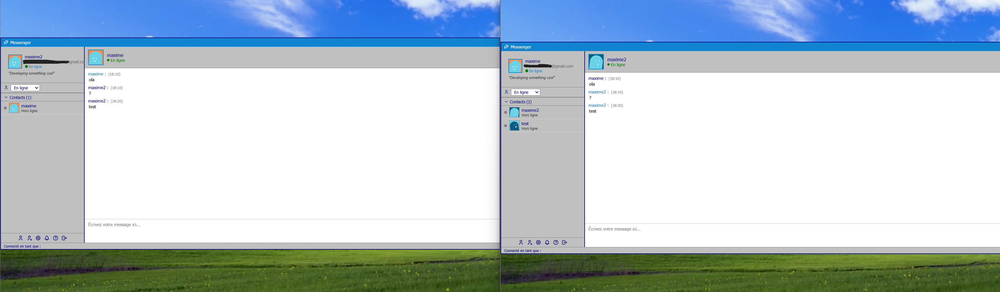
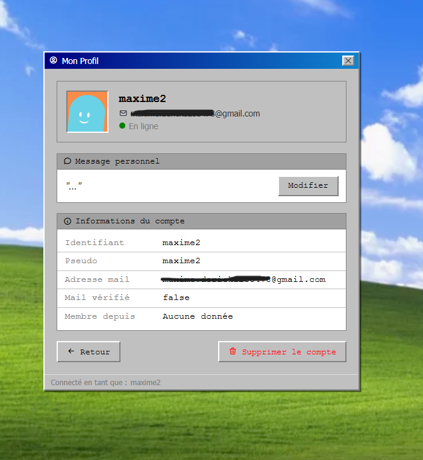
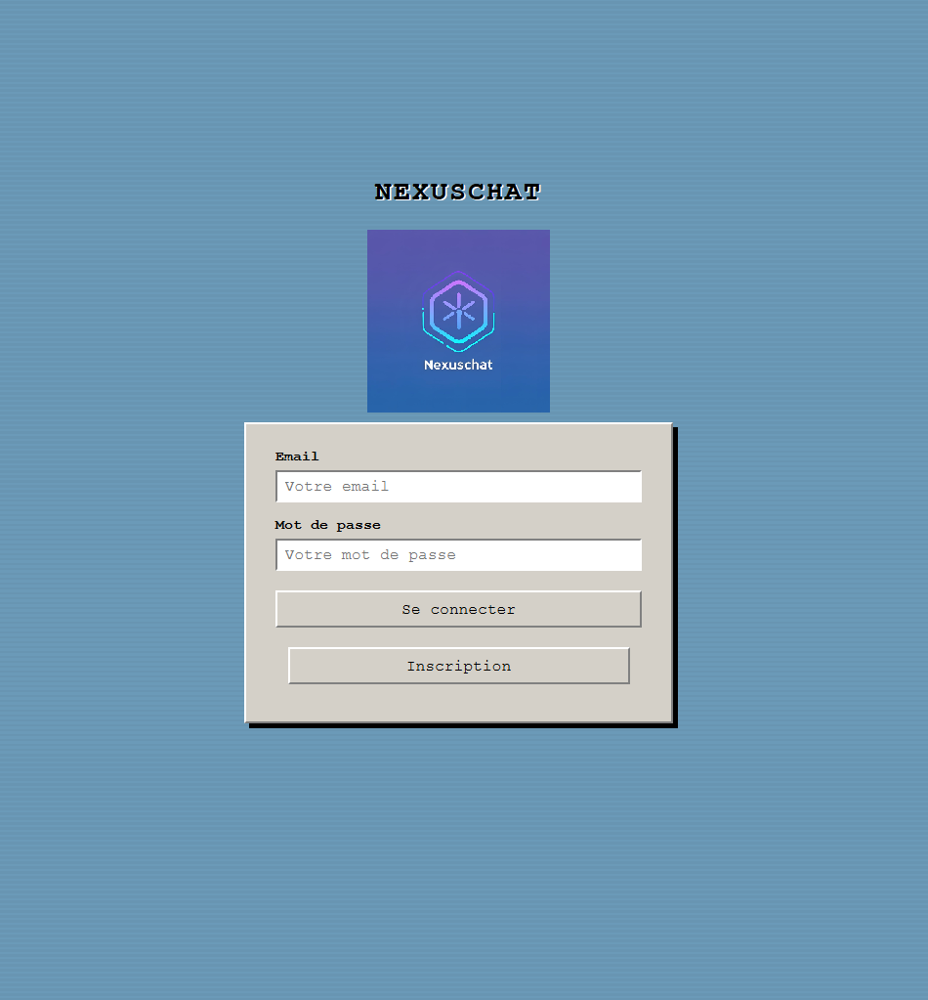
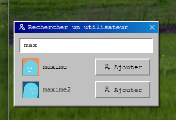

# Nouvelle version de NexusChat
## Changements par rapport à la version précédente

|élément| Ancienne version | Nouvelle version |
|---------- | ---------------- | ---------------- |
| front-end | dart (Flutter)   | HTML/CSS/JS      |
|    API    | Python           | Python |
| Base de données | Mariadb | Mariadb | 

## Interface

J’ai choisi de refaire l’interface en HTML, CSS et JavaScript afin de travailler avec des technologies abordées pendant mon bachelier.

### HTML
- index.html : page d’accueil et d’authentification.
- pages/inscription.html : création d’un compte utilisateur.
- pages/profile.html : affichage du profil.
- pages/loading.html : écran de chargement pendant la récupération des données après l’authentification.
- pages/dashboard.html : espace principal de l’application, qui regroupe les conversations, les contacts et les demandes.
###  CSS
- css/global.css : styles et règles communs à l’application.
- css/ : feuilles de style propres aux différentes pages et composants.

  
### JS 
Les scripts de l’interface se trouvent dans le dossier js/.
- api.js : communique avec l’API Python. Il gère l’authentification, la création de compte, le chargement du profil et des contacts, la recherche d’utilisateurs et les demandes de contact.
- avatars.js : récupère des avatars générés à partir d’un pseudo, les affiche et les enregistre côté API.
- chat.js : gère l’ouverture des conversations, le chargement de l’historique et l’envoi et la réception des messages en temps réel via WebSocket.
- loading.js : anime l’écran de chargement après l’authentification, vérifie qu’un utilisateur est connecté et redirige vers le tableau de bord.
- main.js : configure et lance la fenêtre principale de l’application Electron.
- profile.js : affiche les informations du profil et permet de modifier le message personnel et le statut affiché.
- utilisateurs.js : affiche la liste des contacts, permet de rechercher des utilisateurs et gère l’envoi, l’acceptation et le refus des demandes de contact.

## Python

Les API sont construites en python en utilisant la bibliothèque FASTAPI, l'utilité de ces API servent majoritairement à communiquer avec la base de données.

### arborescence 

- API/
    - .env.example (template des variables d'environnement)
    - avatar.py (API qui concerne les photos de profils)
    - api.js (API qui concernce les features de la dashboard)
    - chat.js (API concernant les conversations)
    - profile.js (API concernant les données profils)
    - utilisateurs.js (API dédié à la gestion de demande de notifications et de recherche d'utiliateurs)
    - loading.js (Script de chargement laissant le temps aux chargements de API.JS)

### Base de données 

## Base de données

NexusChat utilise MariaDB. La base s’appelle `Nexuschat` et stocke les comptes, les contacts, les demandes de contact, les conversations et leurs messages.

### Tables

- **`mail`** : contient l’adresse e-mail de chaque compte et son état de vérification (`mailVerify`). Chaque adresse est unique.
- **`users`** : contient l’identifiant du compte, le lien vers son adresse e-mail et son mot de passe haché. Le mot de passe est enregistré sous forme de hash, jamais en clair.
- **`pseudo`** : associe un pseudo unique à chaque compte.
- **`contacts`** : représente les contacts confirmés entre deux utilisateurs. La paire d’identifiants forme la clé primaire et est enregistrée dans l’ordre croissant.
- **`demandes`** : enregistre les demandes de contact. `fromUser` désigne l’expéditeur et `toUser` le destinataire. Le statut peut être `pending`, `accepted` ou `refused`.
- **`conversations`** : représente une conversation entre deux utilisateurs. La paire d’identifiants est unique et doit être enregistrée dans l’ordre croissant.
- **`message`** : contient les messages d’une conversation, leur auteur, leur contenu et leur date de création. Le destinataire est déterminé à partir des deux participants de la conversation.

### Relations principales

- Un compte (`users`) est associé à une adresse e-mail (`mail`) et à un pseudo (`pseudo`).
- Une conversation (`conversations`) relie deux comptes.
- Chaque message (`message`) appartient à une conversation et est envoyé par un compte.
- Une demande de contact (`demandes`) relie un expéditeur à un destinataire.
- Une fois la demande acceptée, les deux utilisateurs sont enregistrés dans `contacts`.

### Schéma simplifié

MAIL ─── USERS ─── PSEUDO
          │
          ├── CONVERSATIONS ─── MESSAGE
          │       entre 2 users       écrit par 1 user
          │
          ├── DEMANDES
          │    un user envoie une demande à un autre
          │
          └── CONTACTS
               relie 2 users après acceptation

--------------------

### Photos

    

---------------------

---------------------------------

--------------------------------------

-------------------------------------

---------------------------------